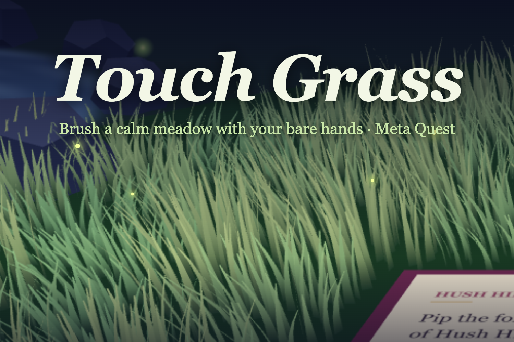
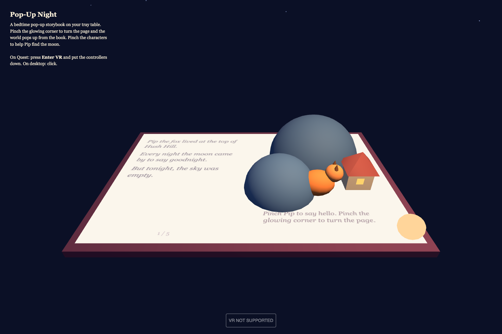

# Touch Grass

A bedtime pop-up storybook that opens on your tray table in VR. Pinch the glowing corner to turn the page, and each page's world pops up out of the book. Pinch the characters to help Pip the fox find the moon. Hands only, seated, about three minutes from first page to goodnight.

**Play:** https://fozagtx.github.io/touch-grass/ (Meta Quest Browser → Enter VR → put the controllers down)

## Try it out
- **Play on Meta Quest:** https://fozagtx.github.io/touch-grass/ (open it in the Quest Browser, tap **Enter VR**, put the controllers down)
- **Desktop preview:** the same link works in Chrome. Move the mouse over the grass to brush it and click to interact. The "VR NOT SUPPORTED" button is expected on a computer without a headset.

## The story (original)
1. **Hush Hill.** Pip's moon is missing. *Pinch Pip to say hello.*
2. **Whisper Wood.** Old Owl says to ask the river. *Pinch Owl and hear a hoot.*
3. **The river.** The stars have fallen asleep. *Pinch all five to wake them and play a lullaby.*
4. **The sky.** A sleepy cloud is hugging the moon. *Tickle it three times and it drifts away.*
5. **Goodnight.** *Pinch the moon:* the room dims and Pip curls up.

## How it works
- WebXR Hand Input. A pinch is the thumb tip within 2 cm of the index tip, released past 3.5 cm.
- The book sits 32 cm below and 45 cm in front of your head on a `local` reference space, so it works in bed, on a couch or on a plane.
- Pop-up animation uses an ease-out-back scale on every piece. Lullaby notes come from Web Audio with no assets.
- three.js r170 from a CDN, no build step, GitHub Pages.

Meta VR Start Developer Competition 2026 · Entertainment · New Experience.

## License
[MIT](LICENSE)
